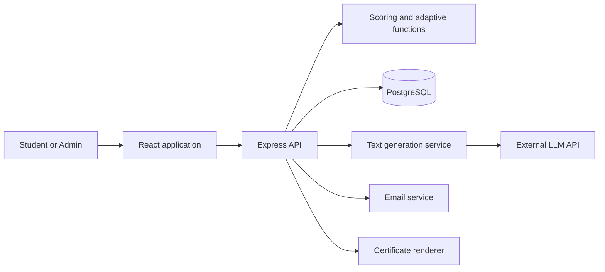
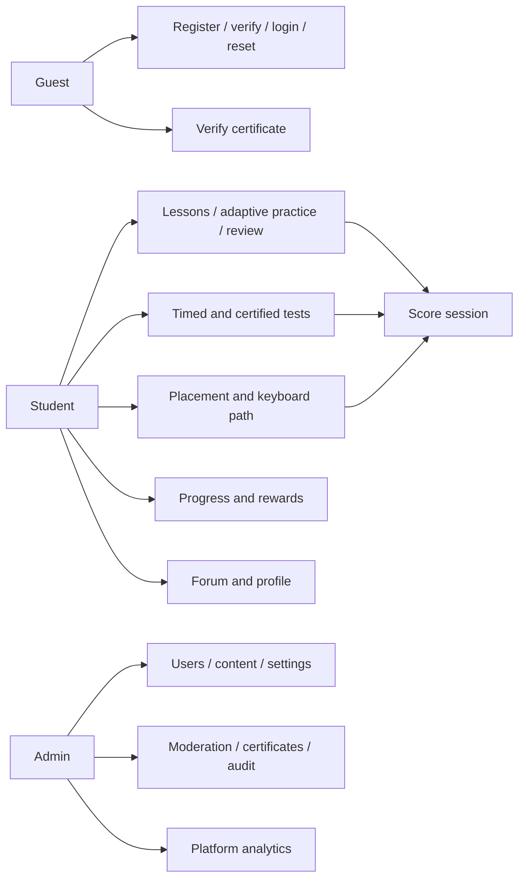
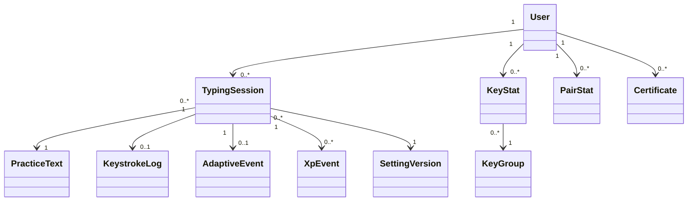

# Software Requirements Specification

## TypeFlow: Adaptive Typing Learning Platform

Prepared by: [Team member names]  
Course: [Course name and code]  
Supervisor: [Instructor name]  
Misr International University  
Version: 1.3 — 15 October 2026

## 1. Preface and document status

This document defines what TypeFlow must do and how its behaviour will be tested. “Shall” marks a mandatory requirement; “should” marks a recommendation. Version 1.3 adopts JavaScript and root-level `client/` / `server/`, retaining Tailwind CSS and the v1.2 Light/Dark, English/Arabic interface and desktop/mobile presentation scope. No implementation was inspected to produce this revision. See [decision 0002](decisions/0002-appearance-localisation-responsive.md) and [decision 0003](decisions/0003-javascript-client-server.md).

This SRS is the requirements baseline. [context/handoff.md](context/handoff.md) explains decisions and remaining questions. [architecture.md](architecture.md) proposes an implementation structure; it does not add requirements. Start at the [documentation index](README.md) for teammate and agent guides.

Numerical engine parameters are initial engineering defaults, not experimentally established learning thresholds. Items explicitly marked **TBD** require team or course confirmation. New behavioural defaults in this revision are documented design choices and may be changed through a recorded decision.

## 2. Introduction

### 2.1 Purpose and objectives

TypeFlow teaches touch typing and helps students improve speed without sacrificing accuracy. It measures errors and latency for individual keys and letter pairs, selects practice from measured weaknesses, and explains its recommendations.

The objectives are to:

- Provide structured lessons, adaptive practice and spaced review.
- Use an accuracy gate before increasing difficulty.
- Generate varied practice through a validated LLM service with a dependable local fallback.
- Track progress and encourage regular practice through XP, levels, goals, streaks and badges.
- Offer unproctored performance certificates with public verification.
- Provide a forum and administration tools.
- Evaluate the adaptive rules honestly using simulations and a small volunteer pilot where feasible.

### 2.2 Scope

**In scope:** email/password accounts, verification and reset; placement; key-group lessons; adaptive practice; spaced review; timed and certified tests; progress and gamification; certificate PDFs and public verification; forum moderation; content, user and settings administration; Light/Dark appearance; English/Arabic interface switching; desktop and mobile layouts for non-typing pages.

**Out of scope:** mobile typing, touch keyboards, layouts other than QWERTY, typing/curriculum languages other than English, automatic translation of authored/user content or certificate PDFs, interface languages beyond English/Arabic, instructor accounts, classes, multiplayer, payments, native apps, Google sign-in, leaderboards, CSV export and AI coaching notes. Optional additions require a scope decision; they are not hidden requirements.

Student and Admin are the only account roles. Guest describes an unauthenticated visitor, not a stored role. Non-typing pages should remain usable on narrow screens; the typing experience targets desktop screens at least 1024 CSS pixels wide.

Arabic localisation applies to interface controls and system-authored explanations, not assigned passages, word lists, physical QWERTY geometry or authored content. Mobile users can access non-typing functions, including administration when authorised, but typing entry points show desktop/physical-keyboard guidance. Responsive design does not expand supported typing devices.

### 2.3 System overview

The React browser application captures exercise input and displays provisional metrics. The Express server replays the input against the assigned text, computes official metrics, updates learning state and persists the result in PostgreSQL. A pure adaptive engine selects the next exercise specification. A generation service supplies validated cached, LLM or fallback text. Email and PDF services support accounts and certificates.

Figure 1. System overview. External service calls do not run inside the result-saving database transaction.

## 3. Similar systems

TypingClub, Keybr, Monkeytype and TypeRacer are reference products for lesson presentation, adaptive typing, typing-test feedback and motivation respectively. TypeFlow combines a structured keyboard path, measured key/pair weaknesses, validated text generation and explainable progression for this course project.

Detailed claims about competitors' current capabilities must be checked before the final academic submission. This revision does not claim that any individual TypeFlow feature is unique or that another product lacks it.

## 4. Glossary

| Term | Definition |
| --- | --- |
| Insert event | One permitted printable character entered into the exercise, including a space |
| Control event | Backspace, pause or resume; it is not a printable-character attempt |
| Gross WPM | Final entered buffer length divided by 5, divided by active minutes |
| Net WPM | Gross WPM minus remaining incorrect characters per active minute, floored at zero |
| Raw accuracy | Correct insert events divided by all insert events; correcting an error does not erase its attempt |
| Final accuracy | Correct characters in the remaining buffer divided by buffer length |
| Latency | Interval between consecutive eligible printable insert events during active typing |
| Key group | A set of characters introduced together, with explicit prerequisites |
| Mastery | Sufficient recent accuracy and latency evidence for a key |
| Accuracy gate | Minimum raw accuracy required to increase difficulty |
| Letter pair | Two adjacent expected letters assessed from eligible consecutive typing events |
| Generation spec | Validated settings describing allowed characters, focus, difficulty and length |
| Certified test | An unproctored TypeFlow performance test using server-assigned text |

These formulas are project conventions. The result screen must label gross WPM, net WPM, raw accuracy and final accuracy separately.

## 5. User classes

| User class | Privileges |
| --- | --- |
| Guest | View landing page; register, verify email, log in, reset password and verify a certificate |
| Student | Practise, take tests, view own progress, earn rewards/certificates, use the forum and manage own account |
| Admin | Manage users, content, settings, moderation, certificates and platform statistics |

The external systems are the LLM API and email service. An Admin account does not automatically imply ownership of a student's private session data; administrative access is explicitly authorised and audited.

## 6. Functional user requirements

1. Users can register, verify email, log in/out, reset passwords and delete their account.
2. Students can type assigned text with accessible character feedback, a next-key keyboard guide and live provisional metrics.
3. Students can take or skip placement, follow the keyboard path, practise weak keys and review previously mastered keys.
4. Practice remains available when the LLM fails or cannot satisfy a generation request.
5. Students can view progress, session history, explanations, XP, levels, daily goals, streaks and badges.
6. Students can take timed tests and qualifying certified tests, download certificates and share verification codes.
7. Students can create forum threads, reply, accept answers on their own threads and report posts.
8. Admins can manage users, content, thresholds, forum moderation and certificate status, and view platform health and usage.
9. Visitors and signed-in users can select Light, Dark or System appearance and English or Arabic interface language independently of English typing content and timezone.
10. Non-typing pages remain usable on desktop and mobile phones in both themes/languages; preferences persist without changing scoring or active assignments.

## 7. Functional system requirements

Original SYS-1 through SYS-45 identifiers are retained so existing references remain useful. New requirements start at SYS-46.

### 7.1 Accounts and authentication

| ID | Requirement |
| --- | --- |
| SYS-1 | Validate email and password policy; reject duplicate normalised email addresses. |
| SYS-2 | Store passwords only as bcrypt hashes; never log passwords or reset tokens. |
| SYS-3 | Send one-time expiring verification links, support rate-limited resend and block login until verified. |
| SYS-4 | Authenticate through a JWT in an httpOnly cookie; apply Secure in production and an explicit SameSite policy; revoke the session on logout. |
| SYS-5 | Send single-use expiring reset links and return the same public response for known and unknown emails. |
| SYS-6 | Enforce role, active-account status and data ownership on every protected server route. |
| SYS-7 | Ignore client-supplied roles during registration; public registration creates Students only. |
| SYS-8 | Rate-limit login, registration, reset and verification/resend routes. |
| SYS-9 | Delete or anonymise personal data according to the deletion rules in section 10. |

### 7.2 Typing input

| ID | Requirement |
| --- | --- |
| SYS-10 | Record ordered insert, backspace and allowed pause/resume events using monotonic timestamps relative to the first insert. The assigned text is stored server-side. |
| SYS-11 | Show correct, incorrect and upcoming characters without relying on colour alone. |
| SYS-12 | Support end-of-buffer Backspace and Shift-produced characters; block paste, drop and unsupported bulk input; ignore held-key repeat events and cursor/selection editing in the exercise. |
| SYS-13 | Start active timing on the first printable insert and apply the mode-specific pause/restart rules in section 8. |
| SYS-14 | Show provisional WPM and raw accuracy and highlight the next expected character on an on-screen keyboard. |
| SYS-15 | Submit the event log and session identity when the exercise completes or the test expires. |

### 7.3 Placement and adaptation

| ID | Requirement |
| --- | --- |
| SYS-16 | Offer placement covering all letters, or allow skipping to the initial home-row group. Insufficient evidence must not imply mastery. |
| SYS-17 | Maintain separate accuracy and latency sample counts, smoothed values, contributing-session counts, mastery state and review date for each key. Maintain corresponding statistics for tracked letter pairs. |
| SYS-18 | Select focus from weak unlocked keys/pairs, due reviews and keys with insufficient evidence. |
| SYS-19 | Apply the raw-accuracy gate and explicit difficulty levels in section 9; never raise difficulty below the gate. |
| SYS-20 | Mark mastery only when all evidence thresholds are met; unlock groups when their prerequisites are satisfied. |
| SYS-21 | Schedule spaced reviews and return a failed mastered key to in-progress status without relocking previously unlocked groups. |
| SYS-22 | Store a readable adaptive reason, engine version and effective configuration snapshot or immutable configuration-version reference. |
| SYS-23 | Return each key's locked, in-progress or mastered state, plus whether review is due. |

### 7.4 Text generation

| ID | Requirement |
| --- | --- |
| SYS-24 | Build a validated generation spec from the engine output, including allowed characters, focus keys/pairs, difficulty, theme, length and configuration version. |
| SYS-25 | Validate all exercise text, including fallback text, for allowed characters, feasible focus coverage, length and blocked content. |
| SYS-26 | Retry invalid LLM output once within a bounded request budget, then use the fallback. |
| SYS-27 | Use fallback on unavailable, rate-limited or timed-out LLM requests; practice shall not depend on LLM availability. |
| SYS-28 | Cache and pre-generate texts; record source, specification, validation version and generation outcomes. Invalidate incompatible cached text after content/rule changes. |
| SYS-29 | Keep LLM credentials on the server and rate-limit generation requests. |

### 7.5 Scoring and integrity

| ID | Requirement |
| --- | --- |
| SYS-30 | Replay the log against the stored assigned text and recompute metrics. Ignore client scores and client claims about expected characters or correctness. |
| SYS-31 | Reject malformed, out-of-order, unauthorised, expired or conflicting submissions and logs violating configured integrity rules. Ordinary wrong characters are scored, not rejected as text mismatches. |
| SYS-32 | Atomically save the official result, raw log, applicable statistics, adaptive event, rewards and certificate record. |

### 7.6 Progress and rewards

| ID | Requirement |
| --- | --- |
| SYS-33 | Show trends, key heat map and session history, with filters separating session modes and difficulty where comparisons would otherwise mislead. |
| SYS-34 | Award accuracy-scaled XP and maintain levels, daily goals and streaks using a validated student timezone. Reward formulas and minimum qualifying activity must be versioned configuration. |
| SYS-35 | Award each badge once and return reward events with the official result. Retries must not duplicate rewards. |

### 7.7 Tests and certificates

| ID | Requirement |
| --- | --- |
| SYS-36 | Offer timed tests of 1, 3 and 5 minutes with enough assigned text to sustain the test. |
| SYS-37 | Use server-assigned certified-test text and issue a certificate only for a valid completed test meeting configured net WPM and raw accuracy requirements. |
| SYS-38 | Give each certificate a unique unguessable verification code, downloadable PDF and public verification page with valid/revoked status. Label it an unproctored TypeFlow performance certificate. |

### 7.8 Forum

| ID | Requirement |
| --- | --- |
| SYS-39 | Allow threads, replies, one accepted answer per thread and post reports; enforce ownership for accepting an answer. |
| SYS-40 | Allow admins to pin threads and hide or delete posts; prevent hidden/deleted content from appearing in ordinary public responses. |

### 7.9 Administration

| ID | Requirement |
| --- | --- |
| SYS-41 | Allow admins to search, deactivate and delete users and create other admins through protected routes; prevent removal of the last active admin. |
| SYS-42 | Allow management of word lists, blocked words, themes and key groups; validate prerequisites and content feasibility before activation. |
| SYS-43 | Allow versioned threshold changes without redeployment; changes apply to new sessions, not retroactively to active/completed sessions. |
| SYS-44 | Show active users, sessions, comparable speed/accuracy aggregates, problem keys, AI validation pass rate and fallback rate with defined reporting windows/denominators. |
| SYS-45 | Record admin actions with actor, action, target, timestamp and a minimal change summary. |

### 7.10 Cross-cutting additions

| ID | Requirement |
| --- | --- |
| SYS-46 | Return the existing official result for an identical retry of a completed submission; reject a different payload for that same session. |
| SYS-47 | Prevent lost updates and duplicate rewards during concurrent submissions using database constraints and a defined per-student update strategy. |
| SYS-48 | Revoke all active sessions after password reset, account deactivation or deletion; enforce revocation server-side. |
| SYS-49 | Protect state-changing cookie-authenticated requests against CSRF, validate origins and use a specific credentialed CORS allowlist where required. |
| SYS-50 | Store the assigned text, mode rules, engine/scoring versions and configuration version with the session. |
| SYS-51 | Apply the fallback feasibility and constraint-relaxation rules in section 9 and record any permitted relaxation. |
| SYS-52 | Run durable, retry-safe retention and generation maintenance jobs with catch-up after downtime. |

### 7.11 Appearance, interface language and responsive presentation

| ID | Requirement |
| --- | --- |
| SYS-53 | Provide Light and Dark appearance on public, Student and Admin screens with a labeled Light/Dark/System selector. System resolves the device preference and explicit Light/Dark overrides it. Apply the chosen mode to controls, charts, passage feedback and overlays without resetting active session state. |
| SYS-54 | Provide an English/Arabic interface selector; translate navigation, controls, help, status/validation labels and system-authored explanations. Arabic uses an RTL shell while English assigned passages/input, key/pair strings and the physical QWERTY guide remain English/LTR. Interface locale shall not translate authored content, change generation/scoring or select another typing language. |
| SYS-55 | Provide desktop and mobile-phone layouts for every non-typing page and required state, including authorised administration, in both themes and interface languages. Mobile typing entry points show device guidance without creating a scored touch session. Resizing/focus changes preserve the existing mode's pause/timing rules. |
| SYS-56 | Persist account appearance/interface preferences for the owner and safe local choices for visitors. Define sign-in precedence, defaults and recovery in section 10.5. Validate allowlisted preference values, merge partial updates without overwriting unrelated fields, and show save failure/retry without a false saved state. |

## 8. Typing, scoring and mode contract

### 8.1 Input and replay

An insert appends one allowed character at the current end position. It is compared with the assigned character at that position, then advances the position even if incorrect. Backspace removes the last remaining character but does not remove the historical attempt. Other navigation/editing commands do not edit the buffer. Modifier keys alone are not insert events. Focus loss triggers the applicable mode rule.

Events have `{ seq, type, t, char? }`. Types are `insert`, `backspace`, `pause`, `resume`; only insert has a `char`. The first insert has `t = 0`; later events have increasing sequence numbers and nondecreasing elapsed timestamps. A server assignment contains the exact text, owner, mode, issue/expiry times and immutable rules. An explicit finish time accompanies submission. The server validates it against events and mode rules; browser timing remains untrusted evidence.

### 8.2 Official formulas

Let `I` be all printable inserts, `C` correct inserts at the time of insertion, `B` remaining buffer length, `F` correct characters remaining at their assigned positions, `U = B - F`, and `M` active duration in minutes.

- Gross WPM = `(B / 5) / M`.
- Net WPM = `max(0, gross WPM - U / M)`.
- Raw accuracy = `100 × C / I`.
- Final accuracy = `100 × F / B`.

Backspace and modifier keys do not add characters to `I` or `B`. Spaces do. Corrected errors remain in `I`. Retyping produces new attempts. A zero denominator produces “not available”, not a perfect score. Sessions with no meaningful positive duration or no printable attempts cannot earn rewards or certificates. Threshold comparisons use unrounded values; display rounding is separate.

For a completed practice passage, duration runs from first insert to the final completing insert, excluding valid pause spans. For a timed test, duration is the entire selected time limit from first insert, including idle time. The unattempted suffix of a timed passage is not counted as incorrect. Events after the deadline do not contribute. A partial or abandoned untimed session has no official learning result.

### 8.3 Session mode rules

| Mode | Pause/focus loss | Restart | Learning updates | Rewards/certificate |
| --- | --- | --- | --- | --- |
| Placement | No pause; focus loss continues time | Abandon and create a new attempt | Establish provisional baseline and starting groups | No XP or certificate |
| Lesson/adaptive practice | Pause allowed; focus loss pauses | Abandon and create a new attempt | Update stats, difficulty and mastery | Qualifying XP, goals, streaks and badges |
| Spaced review | Pause allowed; focus loss pauses | Abandon and create a new attempt | Update stats and review/mastery state | Qualifying XP, goals, streaks and badges |
| Timed test | No pause; focus loss continues time | Abandon and create a new attempt | Save test history; no curriculum/mastery updates | Qualifying XP, goals, streaks and badges |
| Certified test | No pause; focus loss continues time and is recorded | Abandon and create a new attempt | Save test history; no curriculum/mastery updates | Same qualifying rewards; certificate if eligible |

Abandoned attempts cannot award rewards. Hiding the timer in reduced-pressure mode does not change scoring time. Certified tests use a pre-start countdown after the text is ready; scored timing still begins at the first insert. Server-side expiry and elapsed-time checks supplement client timing but do not prove honest input.

Timed assignments must contain enough text for the configured maximum accepted speed and duration, plus a margin. If an assignment is exhausted prematurely, flag a content failure and offer a fresh attempt; do not treat a shorter run as a full-length certified result.

## 9. Adaptive engine and content rules

### 9.1 Statistics and initial parameters

Accuracy statistics use insert attempts attributed to the expected key. Latency samples use two consecutive correct inserts at adjacent positions, with no intervening mistake, backspace or pause. The first insert has no latency sample. Spaces break letter-pair samples. Intervals over the initial 2000 ms learning-latency cutoff are excluded from latency estimates, but still count toward session duration. These exclusions are not fraud verdicts.

Store accuracy and latency evidence separately. Missing latency is unknown, not zero. Common letter pairs follow the same eligibility rules; errors on a pair's second letter can contribute pair-error evidence when the preceding first letter was correctly entered without intervening editing.

| Parameter | Initial default |
| --- | --- |
| EWMA smoothing alpha | 0.2 |
| Raw accuracy gate | 95% |
| Difficulty reduction boundary | Below 90% raw accuracy |
| Target latency | `60000 / (5 × effective target WPM)` milliseconds |
| Weakness | `0.5 × clip((latency-target)/target, 0, 2) + 0.5 × clip(errorRate/0.03, 0, 3)` |
| Focus | Up to 3–5 eligible keys and 2–3 feasible letter pairs |
| Mastery evidence | At least 30 accuracy attempts and 30 eligible latency samples, across at least 2 completed learning sessions |
| Mastery performance | Smoothed error rate at most 3%; latency at most 1.2 × target latency |
| Review intervals | 1, 3, 7, 14 and 30 days |
| Focus coverage | At least 3 occurrences per selected focus key; at least 2 per selected focus pair |
| Text length | Within 15% of requested printable-character length, including spaces |

Unknown keys get explicit exploration priority instead of a fabricated weakness score. The initial selection policy reserves one focus slot for the least-sampled unlocked key when any key lacks mastery evidence, reserves one slot for the most-overdue review when available, then fills remaining slots by weakness without duplicates. If fewer eligible items exist, request fewer focus items. Dedicated review activities take precedence when the student selects Review.

### 9.2 Difficulty, target and placement

Difficulty is separate from unlocking. Levels are: (1) key drills/short words; (2) varied word sequences; (3) short natural passages. Natural passages are permitted only when the allowed character set can support them. Increasing difficulty cannot introduce locked characters. Lowercase letters and spaces are the baseline curriculum; uppercase, punctuation and digits require explicitly authored groups and are not automatically added.

Below 90% raw accuracy, move down one level. From 90% to below the gate, hold. At/above the gate and at/above the effective target net WPM, move up one feasible level. Otherwise hold. Bound changes to the available levels. Record when a content feasibility limit prevents an increase.

The effective target WPM is captured when a session starts. Changing a profile target applies to later sessions and does not revoke prior mastery or certificates. Later reviews use their own captured target. The team's initial default target and permitted target range are **TBD** before engine implementation.

Placement uses a broad text to estimate initial ability, not to award mastery from a few letters. A group can be skipped when each prerequisite letter has at least 3 attempts, no observed errors and at least 2 eligible latency samples within 1.2 × target. Unlock groups only in prerequisite order. Mark skipped groups in progress until ordinary mastery evidence is met. These provisional placement rules must be tested with simulated novices and experienced typists.

### 9.3 Reviews

A review is assessable only when each reviewed key receives at least 5 attempts and 3 eligible latency samples. Insufficient coverage leaves its review stage unchanged. Pass when review-session raw accuracy for the key is at least 97% and mean eligible latency is within 1.2 × its captured target. Advance one interval after a pass; keep repeating at 30 days after the last stage. Failure returns the key to in progress and resets its review schedule; it must regain mastery before the interval sequence restarts. Previously unlocked groups stay unlocked.

### 9.4 Feasible text and fallback

The generator first checks whether the requested alphabet, length and focus coverage can coexist. Spaces are explicitly allowed. Beginners may receive word sequences or labelled drills; natural themed prose is not promised for restricted alphabets.

Fallback order: compatible curated words, then constrained key/pair drills. Theme and natural-prose preference may relax. Locked-character restrictions, blocked-content rules and the selected feasible coverage/length constraints may not silently relax. If the requested focus set is impossible, rebuild the spec with fewer focus items before generation and record why. Content validation must guarantee an initial usable drill for each active group.

### 9.5 Integrity and certificates

Server replay, limits and plausibility checks deter straightforward score tampering; plausible fabricated logs remain possible. A certificate records a claimed account performance in an unproctored test, not verified identity, employability or independently observed human input.

The earlier proposed 250 WPM maximum and intervals under 15 ms are calibration candidates, not universal human limits. Final rejection rules, timing tolerances and flagging thresholds are **TBD** and must avoid treating one short interval as proof of cheating.

The proposed certified-test starting policy is 3 minutes, at least 30 net WPM and 95% raw accuracy. Duration, thresholds, cooldown/attempt limits and displayed certificate name are **TBD** for team approval before certificate implementation.

## 10. Non-functional requirements

### 10.1 Performance and test conditions

- Target input-to-display latency: p95 at most 16.7 ms, with no dropped accepted events in a scripted five-minute typing test. Report measurement method and timer/rendering limits.
- Warm session-submit latency: p95 at most 500 ms under the documented load profile, excluding external service calls, which must not be part of submission.
- Test 200 logged-in concurrent users, with an initial workload of one start and one submit per user per minute plus one dashboard read per 30 seconds. Report achieved throughput, failures and latency; concurrency alone is not a load definition.
- Publish test device CPU/RAM, display refresh rate, browser versions, network latency, dataset size and host resources before accepting these targets. Separate cold-start/free-hosting results from warm results.
- Use compatible cache hits immediately. Bound live generation with an explicit timeout and fall back instead of leaving the session loading indefinitely; timeout value is **TBD** in deployment configuration.

### 10.2 Security and accessibility

Use HTTPS, validated server inputs, ownership checks, CSRF protection, explicit cookie/CORS policy and server-enforced session revocation. httpOnly prevents direct JavaScript reads of the cookie; it does not make the application immune to XSS. Render forum content safely. Limit request/log sizes. Keep secrets outside client bundles and source control.

Support keyboard navigation, visible focus, adequate contrast, non-colour error indicators, large text and reduced-pressure mode. Do not capture typing outside the exercise. Test the exercise in current desktop Chrome, Edge and Firefox, recording actual versions at release.

Light and Dark shall target WCAG 2.2 AA contrast: normal text at least 4.5:1; large text and essential non-text indicators at least 3:1. Test actual foreground/background states, not only palette swatches. Non-typing content shall reflow at 320 CSS pixels without page-wide horizontal scrolling; genuinely two-dimensional data may scroll within an accessible region. Responsive controls should offer at least 44 × 44 CSS pixel hit areas. Verify keyboard, screen-reader, zoom and Arabic mixed-direction behaviour. [DESIGN.md](../DESIGN.md) owns proposed colours, typography, layout breakpoints and reference frames, not scoring thresholds.

### 10.3 Reliability and maintainability

Session submission is atomic and retry-safe. Concurrent results must not lose learning updates. External calls occur outside database transactions. Jobs persist enough state to catch up after a sleeping host resumes, and repeated executions must be safe. Maintain documented backup and restore procedures; verify one restore before release. Hosting limitations must be disclosed in the demo/report.

Use JavaScript ES modules, JSX for React components, pure scoring/adaptive functions, committed migrations, lint/tests/build checks and reviewed pull requests. Share Zod runtime schemas and metric functions, validating data at boundaries. The frontend lives in root-level `client/` and the backend in root-level `server/`. Version scoring, engine configuration and content rules. Defaults live in code; active settings are validated data passed into pure functions.

### 10.4 Privacy, retention and deletion

Keep raw exercise logs for 30 days by default, then delete them through a verifiable retention job. Retain derived session metrics and learning statistics while the account exists. Keep a submission payload hash with the result so identical retries remain recognisable after log expiry. Operational append-only records remain subject to retention and deletion rules.

Account deletion revokes authentication and removes profile data, tokens, logs, learning history and reward records. Delete authored forum text and retain only an anonymous structural placeholder where required for replies. Remove certificate identity and PDF availability; a retained unguessable code may report only “revoked/unavailable”, without personal data. Audit records retain only necessary non-content action metadata and pseudonymise the deleted user. Remove personal data from caches and generated artifacts too.

Public certificate verification exposes only the consented certificate display name, issue date, test duration, metrics, status and verification code; never email or keystroke data. Explain these fields before issuing a certificate. Backup expiry, non-raw operational retention and audit retention durations are **TBD** before production use.

Timezone changes affect future activity-day assignment, not previously awarded days. Record timezone and local date with qualifying activity. Define XP, level thresholds, daily-goal units, minimum session activity and timezone-change handling in versioned reward configuration before gamification implementation.

### 10.5 Presentation preferences and localisation boundary

Default appearance is System, resolved to Light/Dark from the device with Light fallback. Default interface is English; users explicitly choose Arabic. Visitors retain only allowlisted appearance/locale choices locally. At sign-in, confirmed account preferences take precedence; absent account values use the defaults. Guest choices are not silently written to an account. Account updates are owner-only, survive later sign-ins/devices and merge only submitted fields. Pending or failed saves must not be presented as persisted; on failure restore the last confirmed value and offer Retry. On logout, remove the account-scoped preference cache and resolve the visitor's own choice/default so shared devices do not inherit another account's settings.

Appearance/locale are presentation preferences, separate from versioned learning settings, content themes and the student's timezone. Changing them must not remount/reset the recorder, alter assignments/events, unlock characters, recompute old results, move streak days or change certificate issuance. Opening controls still obeys the mode's ordinary focus-loss rules. UI dates may be locale-formatted using the existing saved timezone; exercise/test numbers, durations and verification codes use Western digits with explicit units. Certificate/PDF and user-authored content remain in their existing language; surrounding UI/disclaimers can be localised.

Use reviewed translation dictionaries with stable message/error/reason codes and parameters rather than translating LLM exercise text. Missing interface messages fall back to English without hiding essential information; translation completeness must be checked before release. Language/direction markup distinguishes the Arabic shell from English typing regions. Locale dictionaries are presentation assets and do not belong in generation specifications. Account deletion removes persisted preferences with the profile.

## 11. Technology and constraints

| Layer | Agreed technology |
| --- | --- |
| Front end | React, JavaScript, Vite, Tailwind CSS, React Router, TanStack Query, shadcn/ui |
| Forms/contracts | React Hook Form, Zod; shared runtime schemas, JSON contracts and metric functions |
| Back end | Node.js, Express, JavaScript, cookie JWT authentication, bcrypt |
| Database | PostgreSQL with Prisma; parameterised SQL where appropriate |
| Integrations | Server-only OpenAI-compatible LLM API, SMTP, PDF renderer |
| Development | npm workspaces, Docker for PostgreSQL and Mailpit, GitHub Actions, Vitest |

The planning assumption is five students and 6–8 weeks; confirm the actual deadline and assessment deliverables. Provider/model, hosting and dependency versions are **TBD** and must be verified when selected. Redis, distributed queues and microservices are not required by this design.

**Course dependency:** confirm whether the assessment requires training a model. Statistical rules plus an LLM API do not constitute a specified model-training component. If training is required, revise the plan before implementation.

## 12. System models and page inventory

Figure 2. Use-case overview, expressed as a readable flowchart rather than formal UML notation.

Figure 3. Core conceptual relationships, not a complete database schema. A session can have no raw log after retention or before completion. Letter-to-group membership must be unambiguous in the initial curriculum.

| Page/group | Purpose |
| --- | --- |
| Landing and account pages | Registration, verification/resend, login and reset |
| Student dashboard | Recommended activity and reason, goals, streak, XP, recent sessions |
| Placement and keyboard map | Initial estimate, skip option, groups, mastery and due reviews |
| Typing and review | Passage, accessible feedback, keyboard guide and allowed controls |
| Result | Four labelled metrics, key feedback, rewards and next recommendation |
| Timed/certified tests | Rules, duration choice where allowed, attempt, results |
| Progress and achievements | Comparable trends, heat map, history, badges and levels |
| Certificates and public verification | List, PDF, status and public verification |
| Forum | Threads, replies, accepted answer, reports |
| Profile/settings | Name, timezone, target, daily goal, accessibility, Appearance & language, deletion |
| Admin | Analytics, users, content, settings, moderation, certificates and audit |

This is a page inventory, not a prototype. Use [DESIGN.md](../DESIGN.md) for the proposed desktop/mobile and Light/Dark × English/Arabic screen brief; no Figma prototype or working UI is verified by these documents.

## 13. Scenarios and use cases

**Student:** Layla verifies her account, skips placement and starts with the home row. She completes a lesson at 24 net WPM and 93% raw accuracy. Difficulty holds because she is below the gate, even if corrections produce 100% final accuracy. The next activity targets her weak keys. After sufficient evidence across sessions, keys reach mastery and the next group unlocks.

**Admin:** Omar investigates a rise in fallback rate, updates compatible word lists and validates the change before activation. He changes the accuracy gate through a new settings version. Active sessions keep their original rules; new sessions use the new version. His changes appear in the audit log.

| ID | Use case | Actor |
| --- | --- | --- |
| UC-01 | Register and verify email | Guest |
| UC-02 | Log in/out | Guest, Student, Admin |
| UC-03 | Reset password | Guest |
| UC-04 | Take or skip placement | Student |
| UC-05 | View keyboard map and recommendation | Student |
| UC-06 | Practise weaknesses / review keys | Student |
| UC-07 | Complete typing session | Student |
| UC-08 | Take timed/certified test | Student |
| UC-09 | View progress and rewards | Student |
| UC-10 | Use forum | Student |
| UC-11 | Manage users | Admin |
| UC-12 | Manage content/settings | Admin |
| UC-13 | View analytics and moderate | Admin |
| UC-14 | Generate practice text | Internal service, external LLM |
| UC-15 | Manage profile/delete account | Student |
| UC-16 | Download or verify certificate | Student, Guest |

### UC-07: Complete a typing session

Preconditions: authenticated active student; valid owned assignment. The student enters text, the client submits events, the server validates/replays them, and one transaction saves the result and applicable updates. The response contains official metrics and reward/recommendation events. Identical retries return that result. Malformed/conflicting submissions fail without learning updates; database failures roll back and allow retry. Abandoned sessions do not award rewards.

### UC-14: Generate practice text

Precondition: a feasible spec. Check compatible validated cache, otherwise call the LLM within its budget, validate, retry invalid output once and fall back if needed. Validate fallback too. Record outcomes and any permitted spec relaxation. Return usable text or a clear content-configuration error; never serve unvalidated text.

## 14. Form-based and tabular specifications

| Function | Inputs | Output/postcondition |
| --- | --- | --- |
| Login | Email, password | Verified active account receives a revocable cookie session and role; failures give a safe error |
| Submit | Session ID, ordered events, finish time | Official result saved once with applicable learning/reward/certificate records |
| Change settings | Validated settings, expected current version | New immutable version and audit entry; current sessions unchanged |

| Submit condition | Action |
| --- | --- |
| Valid owned unsubmitted session | Replay, score and atomically save |
| Identical completed submission | Return saved result; no second update |
| Different submission for completed session | Reject conflict |
| Another student's session | Deny access |
| Incorrect typed characters | Count errors normally |
| Invalid event sequence/assignment/integrity rule | Reject with a useful reason |
| Database failure | Roll back and permit retry |
| Raw accuracy below 90% in learning mode | Lower difficulty within bounds |
| Raw accuracy meets gate and net WPM meets target | Raise one feasible difficulty level |

## 15. Verification and evaluation

Use unit tests for replay, formulas, eligibility rules, adaptation and fallback feasibility; integration tests for ownership, atomic updates, retries, concurrency, revocation and deletion; browser tests for the full typing flow, accessibility and mode controls. Include fixed scoring examples covering correction, pauses, unfinished timed text and zero denominators. Map each SYS requirement to a test or manual acceptance check before release.

For SYS-53–56 verify both appearance modes and System resolution; English/Arabic selection, RTL/LTR isolation and unchanged English assignments; desktop/mobile reflow and device guidance; account/visitor precedence, logout, reload and save failure; unchanged recorder/timing/scoring across presentation changes. Record rendered contrast and keyboard/screen-reader results separately from token calculations.

Compare adaptive and fixed-curriculum practice using the same simulated typist profiles, initial conditions, practice budgets and a common held-out assessment. Use multiple random seeds and report variability. Include slow-accurate, fast-inaccurate, novice and uneven-key profiles. Tune on separate simulation profiles from those used for final reporting. Simulated learning assumptions must not inherently reward the adaptive policy.

Simulation shows behaviour under stated assumptions, not proof that humans learn faster. A small consented classmate pilot can assess usability and provide limited learning evidence; report its sample size, duration and limitations.

## 16. Open decisions and release gates

Before engine work: confirm the course's trained-model requirement, target WPM defaults/range and curriculum groups. Before integration: agree exact API schemas, configuration validation, reward rules and integrity tolerances. Before certificate work: approve certificate policy. Before deployment: confirm providers, hosting, retention, reference performance environment and backup procedure. Confirm deadline, project name and required prototypes/diagrams with the team.

Core adaptive behaviour, validated fallback and evaluation take priority. Forum, certificates and basic admin remain required in this baseline; reducing them requires an explicit SRS revision.

## 17. Future enhancements

Instructor/class support, additional keyboard layouts/typing languages, interface languages beyond English/Arabic, multiplayer, optional sign-in providers and recalibration from real learner data may be considered after the required baseline is complete.

## 18. References

- Original supplied TypeFlow SRS, handoff context and structure proposal, revised through the document review of 13 October 2026.
- Product references for later comparison verification: TypingClub, Keybr, Monkeytype and TypeRacer.
- Implementation references to consult when pinning versions: official React, Express, Prisma, PostgreSQL and chosen LLM-provider documentation.
- ISO/IEC/IEEE 29148:2018 and IEEE 830-1998 were cited in the original SRS; this document does not claim formal compliance with either standard.
